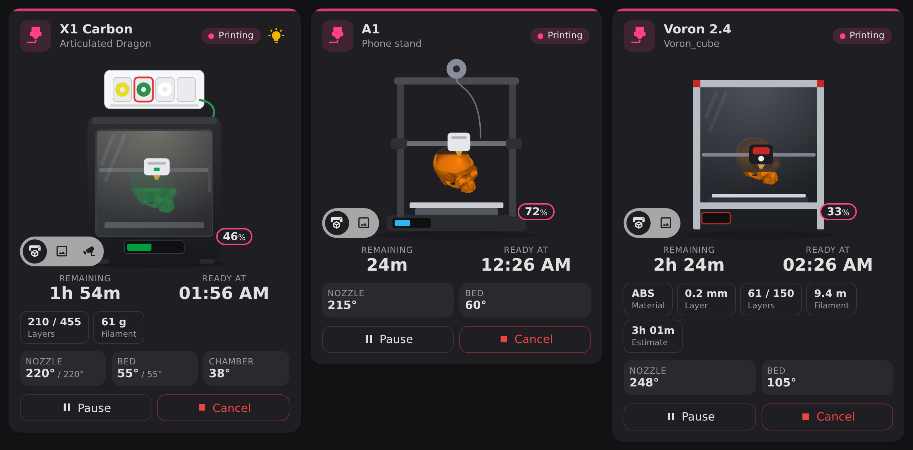
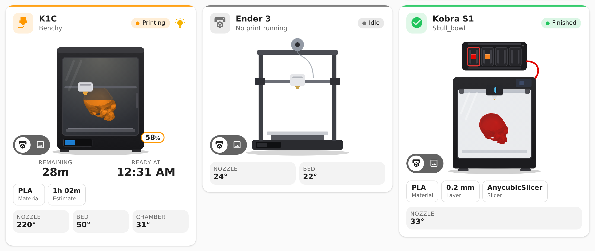
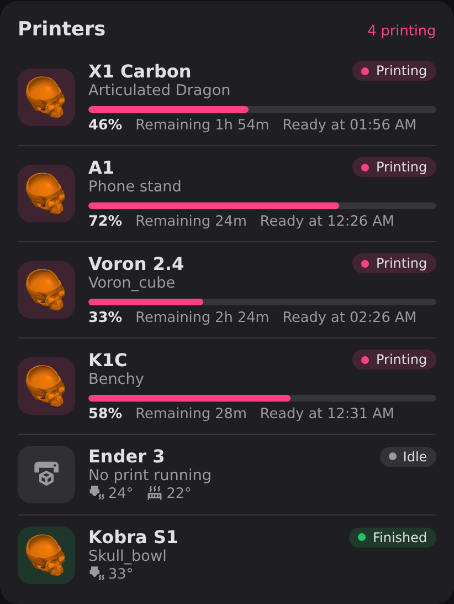

# Universal 3D Cards

[](https://hacs.xyz/)
[](https://github.com/Rein033/universal-3d-cards/actions/workflows/validate.yml)
[](https://github.com/Rein033/universal-3d-cards/releases)
[](https://buymeacoffee.com/rein033)

**One dashboard card for all your 3D printers.** A drawn printer with your print growing inside it, live camera,
slicer info, AMS/ACE spools in their real colours, temperatures and controls. Works with the 3D printer integrations
you already use, with a visual editor and no YAML needed.



## Supported printers

| Integration | Printers | Drawing |
|---|---|---|
| [Bambu Lab](https://github.com/greghesp/ha-bambulab) | X1, P1S, P1P, P2S, H2D, A1, A1 mini | Enclosed with AMS on top, or bed slinger for A1 |
| [Moonraker](https://github.com/marcolivierarsenault/moonraker-home-assistant) | Klipper: Voron, RatRig, Sovol, Ender with Klipper, … | Voron frame, or bed slinger |
| [Creality (local)](https://github.com/3dg1luk43/ha_creality_ws) | K1, K1C, K1 Max, K2, Hi, Ender-3 V3 | Creality K1 style, or bed slinger |
| [Creality Cloud](https://github.com/Rein033/ha-creality-cloud) | Printers in the Creality Cloud app | Creality K1 style, plus print history and timelapse |
| [Anycubic Cloud](https://github.com/WaresWichall/hass-anycubic_cloud) | Kobra S1, Kobra 2/3, … | Kobra S1 with ACE Pro, or bed slinger |
| [OctoPrint](https://www.home-assistant.io/integrations/octoprint/) (built in) | Anything running OctoPrint | Bed slinger |

The card finds a printer's entities by itself: pick any entity of the printer, and it uses the integration's internal
keys (or entity IDs for Moonraker and OctoPrint). Renaming entities does not break it. The drawing is picked from the
printer model; you can override it in the editor.

## Features

- **Drawn printer** with the print preview growing inside it, tinted in the active filament colour. The toolhead moves
  while printing.
- **Three views**, switchable on the card: the drawing, a progress ring with the preview, and the **live camera**.
- **Slicer info**: material, layer height, layers, filament used or weight, slicer estimate, slicer.
- **Spools**: Bambu AMS and Anycubic ACE slots in their real colours, the active one outlined.
- **Temperatures** of nozzle, bed and chamber (or ACE), with the target while heating.
- **Controls**: pause, resume, cancel (with confirmation) and the printer light.
- **Firmware update** badge when the integration reports one.
- **Printer group card**: all printers in one compact list with progress and finish time.
- Follows your theme (light and dark) and language (English and Dutch).



## Fast on every device

The card is built to stay light, also on wall tablets:

- It only redraws when one of its own printer's entities changes, and finds those entities once instead of on every
  state change in Home Assistant.
- The toolhead animation moves a separate layer that the browser only shifts around. The drawing itself is never
  repainted for it. The animation pauses when the card is off screen and respects "reduce motion".
- The camera only streams while the camera view is visible.

## Installation

### HACS

[](https://my.home-assistant.io/redirect/hacs_repository/?owner=Rein033&repository=universal-3d-cards&category=plugin)

Or: HACS → ⋮ → **Custom repositories** → `https://github.com/Rein033/universal-3d-cards`, type **Dashboard** →
**Download**. HACS adds the dashboard resource for you.

### Manual

Copy `universal-3d-cards.js` to `/config/www/` and add `/local/universal-3d-cards.js` as a dashboard resource of type
*JavaScript module* (Settings → Dashboards → ⋮ → Resources).

## Usage

Add the card from the card picker (search for **3D Printer**) and set it up in the visual editor, or use YAML:

```yaml
type: custom:printer-3d-card
entity: sensor.x1c_print_status   # any entity of the printer
```

| Option | Default | Description |
|---|---|---|
| `entity` | – | Any entity of the printer. |
| `name` | device name | Title on the card. |
| `view` | `printer` | Start view: `printer` (drawing), `preview` (progress ring) or `camera`. |
| `drawing` | `auto` | `auto`, `bambu`, `bedslinger`, `voron`, `k1`, `kobra` or `enclosed`. |
| `show_slicer` | `true` | Slicer info chips. |
| `show_temperatures` | `true` | Nozzle, bed and chamber temperature. |
| `show_controls` | `true` | Pause / resume / cancel and the light button. |
| `show_view_switch` | `true` | The view switch on the card. |
| `show_history` | `true` | History button with timelapse and print again (Creality Cloud only). |

### Printer group



```yaml
type: custom:printer-3d-group-card
title: Printers          # optional
entities:                # optional, default: every printer found
  - sensor.x1c_print_status
show_idle: true          # also show idle and offline printers
```

## FAQ

**My printer is not found.** The card only knows the integrations in the table above. Open an issue with the
integration name and a list of the printer's entities (Settings → Devices & services → your printer).

**The camera view is missing.** It only appears when the integration provides a camera entity for the printer (Bambu
Lab, Moonraker webcams, Creality local, OctoPrint, Anycubic).

**I don't see slicer info.** It comes from the integration, or from the file name when it contains it (for example
`Benchy_PLA_0.2_1h12m.gcode`). Not every slicer and integration provides it.

## Development

The card is plain JavaScript without dependencies. Edit the files in `src/` and run `./build.sh`, which glues them into
`universal-3d-cards.js` (the file HACS serves). CI checks that the built file matches `src/`.

## Support

Everything here is free. If it saves you time or makes your dashboard nicer, you can [buy me a coffee](https://buymeacoffee.com/rein033) ☕

## License

[MIT](LICENSE). The printer drawings are original artwork. Bambu Lab, Creality, Anycubic, Voron, Klipper and OctoPrint
are names of their respective owners; this project is not affiliated with them.
